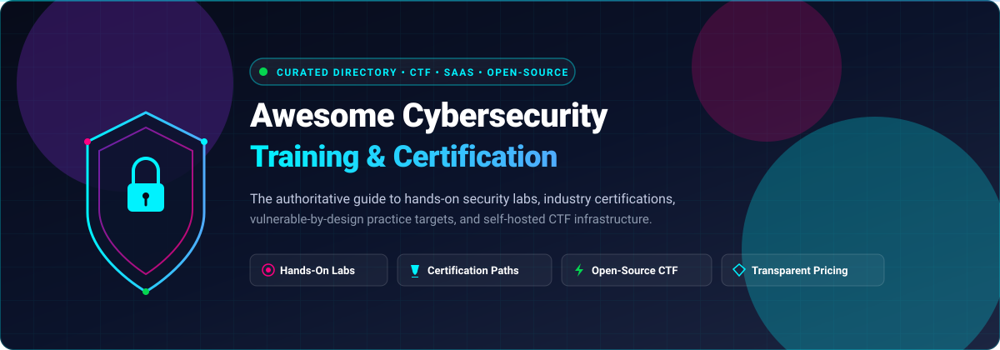

# 🛡️ Awesome Cybersecurity Training &amp; Certification

**The definitive curated directory of Cybersecurity Training Platforms, Industry Certification Programs, Hands-On CTF Labs, and Self-Hosted Open-Source Practice Ranges. 🌟 Star if you find this valuable! 🌟**

*Comprehensive guide for SOC Analysts, Penetration Testers, DevSecOps Engineers, Security Architects, and CTF Competitors.*

📅 **Last updated: November 2026**

---

## 📌 Executive Summary &amp; Overview

This repository provides an authoritative, transparent index of **commercial SaaS cybersecurity platforms** and **battle-tested open-source security training environments**. Whether you are studying for premier offensive security certifications (like OSCP, eJPT, CEH, GIAC), building foundational cybersecurity competencies (CompTIA Security+, Google Cyber Certificate), setting up internal enterprise red/blue team drills, or self-hosting Capture-the-Flag (CTF) events, this directory delivers actionable comparisons with verified pricing, free-tier limitations, and GitHub community metrics.

### 🎯 Key Highlights:
- 📊 **Transparent SaaS Matrix**: Upfront breakdown of starting prices, enterprise valuation tiers, and verified free-tier limits without marketing ambiguity.
- 🔓 **Ranked Open-Source Practice Ranges**: Curated vulnerable-by-design applications, cloud labs, and CTF engines with live star tracking.
- 🚀 **SEO &amp; Skill Aligned**: Cross-referenced with DoD 8570/8140 standards, MITRE ATT&amp;CK frameworks, and OWASP security practices.

---

## 📑 Table of Contents

- [🌐 Sector Overview &amp; Market Dynamics](#-sector-overview--market-dynamics)
- [💼 SaaS &amp; Commercial Hosted Platforms](#-saas--commercial-hosted-platforms)
- [🔓 Open-Source GitHub Projects &amp; Practice Ranges](#-open-source-github-projects--practice-ranges)
- [🛠️ How to Combine Platforms &amp; Self-Hosted Labs](#️-how-to-combine-platforms--self-hosted-labs)
- [🤝 How to Contribute](#-how-to-contribute)
- [💖 Support &amp; Community](#-support--community)
- [📈 Star History](#-star-history)
- [⚠️ Disclaimer](#️-disclaimer)

---

## 🌐 Sector Overview &amp; Market Dynamics

The global cybersecurity training and workforce development market is valued between **$7 billion and $18 billion** (with broad enterprise security awareness, cyber ranges, and workforce upskilling projected to surpass **$25 billion by 2030** at a **12%–16% CAGR**). 

The sector displays a **moderately fragmented** competitive structure:
- **Accreditation &amp; Enterprise Giants**: Industry veterans and legacy bodies such as SANS Institute (GIAC), CompTIA, and enterprise tech vendor academies like CrowdStrike University command large shares of corporate compliance training and government DoD-mandated budgets.
- **Hands-On Dynamic Innovators**: High-growth cloud cyber ranges and gamified lab platforms—primarily Hack The Box, TryHackMe, and OffSec—have captured the practitioner and offensive security mindset through realistic penetration testing simulations and continuous credentialing.
- **Open-Source Foundations**: An active community anchored by OWASP, Vulhub, and CTFd provides the essential, self-hosted infrastructure used by universities, DEF CON workshops, and enterprise security departments worldwide.

---

## 💼 SaaS &amp; Commercial Hosted Platforms

| Platform | Company Size (Revenue / Valuation) | Pricing | Free Tier / Trial Limits | Description &amp; Best For |
| :--- | :--- | :--- | :--- | :--- |
| **[CrowdStrike University](https://www.crowdstrike.com/)** | **~$250B+ valuation** (~$4.8B FY2026 ARR / revenue) | Starts at **$500 per training credit**; exam vouchers at **$250/exam**; annual LMS subscriptions quoted per seat/team | **No free tier for non-customers**; free **Fast Track (100-level)** e-learning modules &amp; product update videos included strictly for active Falcon enterprise subscribers | Product-specific education for the Falcon endpoint security platform. Best for enterprise security teams and SOC analysts operating CrowdStrike Falcon. |
| **[Pluralsight](https://www.pluralsight.com/)** | **~$3.5B private buyout** (recapitalized / $450M+ ARR) | Core Tech starts at **$45/month** or **$449/year**; Complete starts at **$29–$55/month** or **$299/year** billed annually | **10-day free trial** with full course library access (limited to 200 minutes of video streaming; excludes hands-on interactive labs and sandboxes; requires credit card) | Enterprise technology skill-building and cert prep across security, cloud, and IT ops. Best for cross-functional engineering and IT teams. |
| **[Coursera](https://www.coursera.org/)** | **~$1.2B market cap** (~$757M FY2025 revenue) | Coursera Plus at **$59/month** or **$399/year**; individual certificates start at **$49/month** | **Free Audit mode** available indefinitely on most non-degree courses (video lectures and readings only; excludes graded assignments, certificates, and interactive labs); **7-day free trial** for Coursera Plus | Academic and foundational certification paths (e.g., Google Cybersecurity Certificate). Best for beginners wanting structured university/industry lectures. |
| **[SANS Institute](https://www.sans.org/)** | **~$500M–$1B estimated revenue** (Escal Institute) | Single course starts at **$8,900** (SEC504) or **€8,230** (SEC560); GIAC exam attempt adds **$999 / €905**; SANS.edu graduate cert at **$22,800** | **No free trial for full OnDemand courses**; free community tier includes **100+ archived webcasts, security policy templates, cheat sheets, and course preview video demos** with a free SANS account | Premier, intensive cybersecurity training and gold-standard GIAC certifications. Best for enterprise-sponsored practitioners and senior defense/offensive personnel. |
| **[CompTIA Security+](https://www.comptia.org/)** | **~$200M–$280M+ estimated revenue** | Exam voucher starts at **$373.15** ($439 retail); Voucher + Retake Assurance at **$492.15**; CertMaster Learn course starts at **$561** | **No free tier for certification exams**; **60-day evaluation trial** offered selectively for CertMaster Practice/Learn through institutional or partner demo keys (restricted sample lesson subset) | Baseline vendor-neutral cybersecurity certification for DoD 8570/8140 compliance and foundational HR screening. Best for IT professionals starting in info security. |
| **[Hack The Box](https://www.hackthebox.com/)** | **~$250M–$500M valuation** ($55M Series B; ~$30M–$50M ARR) | VIP+ at **$25/month** or **$223/year**; HTB PRO at **$49/month** or **$490/year**; Academy Silver at **$550/year**; Student at **$10/month** | **Free for life tier** with **20 active Machines, 80+ active Challenges**, and a **one-time 2-hour Pwnbox trial** | Gamified offensive and defensive hands-on hacking labs and structured Academy paths. Best for intermediate-to-advanced penetration testers and CTF players. |
| **[OffSec](https://www.offsec.com/)** | **~$50M–$100M+ estimated revenue** (Acquired by Leeds Equity) | Course + Cert Bundle starts at **$1,749** (90-day lab access + 1 exam); CyberCore at **$899**; Learn Fundamentals at **$799/year**; Learn One at **$2,749/year** | **Free tier via OffSec Community Portal** with **3 hours/day access to Proving Grounds Play** (community standalone machines), plus full free access to PEN-103 (Kali Linux Revealed) and Metasploit Unleashed | Industry-standard rigorous hands-on certifications (OSCP, OSWE, OSEP). Best for infosec professionals pursuing recognized practical offensive credentials. |
| **[TryHackMe](https://tryhackme.com/)** | **~$30M–$40M+ ARR** (Bootstrapped) | Premium starts at **$16.99/month** or **$10.50/month ($126/year)** billed annually; MAX plan starts at **$29.11/month** or **$17.99/month** billed annually | **Free for life tier** with access to introductory rooms, foundational learning paths, OpenVPN connection, and **1 hour per day of browser AttackBox** | Hands-on, step-by-step guided security challenges and beginner-to-intermediate learning paths. Best for beginners and aspiring security analysts/pentesters. |
| **[Cybrary](https://www.cybrary.it/)** | **~$30M–$32M ARR** ($52.2M VC funding raised) | Insider Pro starts at **$24.58/month billed annually** ($295/year) or **$39/month** month-to-month | **Free for life tier** with access to baseline introductory skill paths and a daily limit of **10 learning activities/day**; **7-day free trial** for Insider Pro full catalog access | Career-aligned cybersecurity paths, prep for industry certs, and skill assessments. Best for self-paced learners wanting affordable structured guidance. |
| **[INE Security](https://security.ine.com/)** | **~$20M–$50M estimated revenue** (West Street / Goldman Sachs PE) | Fundamentals starts at **$349/year**; Premium starts at **$39/month** ($468/year) or **$799/year** (includes eJPT/eCPPT courseware &amp; exam vouchers) | **No ongoing free tier for full catalog**; historically offered a restricted 'Starter Pass'; currently offers limited sample lessons and occasional **7-day promotional evaluation trials** (video-only previews, no advanced labs) | Practical hands-on training with included certifications (eJPT, eCPPT, eWPT). Best for learners seeking affordable practical offensive certifications. |

---

## 🔓 Open-Source GitHub Projects &amp; Practice Ranges

*Self-hosted training frameworks, deliberately vulnerable targets, red team emulation suites, and CTF competition engines sorted in descending order by GitHub community stars.*

| Repository | GitHub Stars | Primary License | Focus Area &amp; Architecture | Description &amp; Best For |
| :--- | :--- | :--- | :--- | :--- |
| **[OWASP Cheat Sheet Series](https://github.com/OWASP/CheatSheetSeries)** |  | CC-BY-SA-4.0 | Defensive Engineering &amp; AppSec | Curated, high-value security guidance for developers and defenders covering authentication, input validation, cryptographic storage, and API security. Best reference for secure coding and hardening. |
| **[Vulhub](https://github.com/vulhub/vulhub)** |  | MIT | Pre-built Docker Vulnerability Environments | Turnkey collection of hundreds of real-world vulnerabilities simulated in Docker containers. Spin up complex multi-service CVE exploits with a single `docker compose up` command. |
| **[OWASP Juice Shop](https://github.com/juice-shop/juice-shop)** |  | MIT | Modern Web Application Security | Modern, rich JavaScript/TypeScript app with 100+ challenges spanning OWASP Top 10 vulnerabilities, gamified scoreboards, and CTF integration. The premier target for web security training. |
| **[DVWA (Damn Vulnerable Web App)](https://github.com/digininja/DVWA)** |  | GPL-3.0 | Classic Web App Security (PHP/MySQL) | Deliberately vulnerable PHP application with four switchable security difficulty levels (Low, Medium, High, Impossible). The canonical starting playground for ethical hacking fundamentals. |
| **[Atomic Red Team](https://github.com/redcanaryco/atomic-red-team)** |  | MIT | Blue Team Detection &amp; Adversary Emulation | Library of simple, portable, automated tests mapped directly to the MITRE ATT&amp;CK framework. Essential for defenders validating SOC detections, SIEM alerts, and EDR triggers. |
| **[OWASP WebGoat](https://github.com/WebGoat/WebGoat)** |  | Apache-2.0 | Java / Enterprise Application Security | Deliberately insecure Java application maintained by OWASP designed to teach enterprise web application security flaws and code-level remediation through interactive lessons. |
| **[CTFd](https://github.com/CTFd/CTFd)** |  | Apache-2.0 | Capture The Flag Competition Engine | The de facto global standard open-source platform for hosting CTF events. Features dynamic scoring, challenge unlocking, plugin ecosystem, team scoreboards, and Docker deployability. |
| **[FBCTF](https://github.com/facebookarchive/fbctf)** |  | BSD-3-Clause | Gamified CTF Platform (Risk-style map) | Competition platform developed by Facebook featuring an interactive territory-conquest world map for Jeopardy-style and King-of-the-Hill hacking challenges. |
| **[Metasploitable 3](https://github.com/rapid7/metasploitable3)** |  | BSD-style | Full-system Infrastructure VM Range | Automated build scripts using Packer and Vagrant to spin up intentionally vulnerable Windows and Ubuntu VMs. Ideal for network-level vulnerability assessment and penetration testing. |
| **[CloudGoat](https://github.com/RhinoSecurityLabs/cloudgoat)** |  | BSD-3-Clause | AWS Cloud Security "Vulnerable by Design" | Rhino Security Labs' framework for provisioning intentionally misconfigured AWS environments via Terraform. Practice IAM privilege escalation, S3 leaks, and ECS attacks. |
| **[SecGen](https://github.com/cliffe/SecGen)** |  | GPL-3.0 | Procedural Vulnerable VM Generator | Creates randomized, deliberately vulnerable VirtualBox/Vagrant VMs dynamically based on scenario templates. Eliminates cheat sheets during student security assessments. |
| **[OWASP NodeGoat](https://github.com/OWASP/NodeGoat)** |  | Apache-2.0 | Full-Stack Node.js Security | Educational platform providing an interactive environment to learn the OWASP Top 10 security risks tailored specifically for Node.js and MongoDB applications. |
| **[OWASP Security Shepherd](https://github.com/OWASP/SecurityShepherd)** |  | GPL-3.0 | Web &amp; Mobile AppSec Training Range | Gamified training management system designed to introduce both novice and advanced learners to web and mobile application security flaws in a competitive environment. |
| **[OWASP RailsGoat](https://github.com/OWASP/railsgoat)** |  | MIT | Ruby on Rails Application Security | Vulnerable Ruby on Rails 7 application educating developers and security analysts on misconfigurations and vulnerabilities unique to Rails frameworks and ActiveRecord ORMs. |
| **[DVNA (Damn Vulnerable NodeJS)](https://github.com/appsecco/dvna)** |  | MIT | Lightweight Node.js / SQL / NoSQL Target | Deliberately vulnerable NodeJS application demonstrating SQL injection, XSS, insecure dependencies, SSRF, and command injection with Docker quick-start. |
| **[OWASP VWAD](https://github.com/OWASP/www-project-vulnerable-web-applications-directory)** |  | CC-BY-SA-4.0 | Global Directory of Insecure Labs | Comprehensive OWASP community index cataloging dozens of vulnerable web, API, mobile, IoT, and cloud applications across diverse architectures and technology stacks. |

---

## 🛠️ How to Combine Platforms &amp; Self-Hosted Labs

Building a high-impact cybersecurity skills progression is most cost-effective when combining structured cloud curricula with self-hosted ranges:

1. **Foundational &amp; Theory**:
   - Begin with structured learning paths on **TryHackMe** or **Coursera (Google Cybersecurity Certificate)** to build core networking and Linux security literacy.
2. **Defensive Detection &amp; Engineering**:
   - Study **OWASP Cheat Sheet Series** guidelines.
   - Run **Atomic Red Team** atomic tests against your local virtual machines to observe real-time telemetry and write defensive detection rules.
3. **Web &amp; Application Security**:
   - Deploy **OWASP Juice Shop** or **DVWA** locally using Docker to practice web attack vectors (SQLi, XSS, SSRF, broken auth) without breaking external network rules.
4. **Cloud Infrastructure Security**:
   - Provision **CloudGoat** scenarios inside an isolated AWS sandbox to understand IAM privilege escalation and cloud configuration pitfalls.
5. **Team Exercises &amp; CTF Competitions**:
   - Deploy **CTFd** on a small cloud droplet or local network, load challenge sets from **Vulhub** or custom targets, and run collaborative internal hacking challenges.
6. **Advanced Industry Certifications**:
   - Graduate to **Hack The Box** Pro Labs and **OffSec (PEN-200 / OSCP)** for realistic, multi-machine offensive pivoting environments.

---

## 🤝 How to Contribute

Contributions are welcome and actively encouraged! To submit additions or corrections:

1. 🍴 **Fork the Repository** on GitHub.
2. 🌿 **Create a New Branch** (`git checkout -b feature/add-new-resource`).
3. ✏️ **Edit `README.md`**: Follow the established formatting (include exact pricing details, verified free-tier limits, license, and repository star metrics).
4. 🧪 **Verify URLs**: Ensure links are live and direct (avoid tracking redirects).
5. 🚀 **Submit a Pull Request** with a brief summary of why the resource belongs in this directory.

---

## 💖 Support &amp; Community

If this repository has helped accelerate your cybersecurity career, certification prep, or internal training labs, consider supporting its continuous maintenance:

- ⭐ **Star this repository** to improve visibility across the cybersecurity community!
- 🍴 **Fork and share** with colleagues, students, and CTF teammates.
- 💬 **Join the conversation** on [Discord](https://discord.gg/jc4xtF58Ve) to connect with fellow security researchers.
- ☕ **Support the maintainer**: Buy a coffee and support open-source work via the [GitHub Sponsor Dashboard](https://github.com/sponsors/ishandutta2007).

---

## 📈 Star History

---

## ⚠️ Disclaimer

- This curated list is maintained for **educational, instructional, and authorized workforce development purposes only**.
- Always adhere to ethical security disclosure practices and local computer misuse statutes. Never execute security testing or vulnerability assessment tools against systems without express, documented authorization from the asset owner.
- Vulnerable-by-design applications (such as DVWA, Juice Shop, and Metasploitable) contain intentional critical vulnerabilities; always run them within isolated network boundaries or contained virtual environments.
- All product names, logos, and brands are property of their respective owners. Pricing and subscription tiers fluctuate periodically; verify current terms directly with providers.

---

  <b>Built with ❤️ for security researchers, CTF organizers, defenders, and ethical hackers worldwide.</b>

